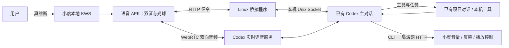

# 小度贾维斯：给旧智能屏接上自己的 Agent

把一台**小度智能屏 1S**变成能唤醒、连续交谈、插话打断、执行任务的语音终端。

这套代码已经在作者自有设备上用于日常对话：本地检测唤醒词，屏幕显示动态光球，通过 WebRTC 与 Codex 的实时语音连接；仍沿用自己的主对话，工具任务可以由它处理或分配给已有项目对话。挂断后释放通话麦克风，回到等待唤醒。

**公开版首次发布：v0.1.0。** [下载工具包与 APK](https://github.com/NoobMaster233/xiaodu-jarvis/releases/tag/v0.1.0) · [从这里开始安装](docs/quickstart.md)

> 适配机型是 **小度智能屏 1S，XDH-29-B1 / MT8167 / Android 8.1 / ARMv7**，不是“小度在家 1S”。设备需要已经取得 root 和 Magisk；[解锁与 root 教程](https://github.com/NoobMaster233/xiaodu-smart-screen-1s-root)是单独的前置项目。
>
> Codex 的 `thread/realtime/*` 是 **experimental 接口**，不是稳定的通用 Realtime API。需要现有 Codex 登录、支持相应功能的账号和本机 app-server；未来版本可能变化。首次发布的完整构建与安装工具面向 Linux，不承诺 Windows 一键安装。

## 能做什么

- 本地中文唤醒，无需持续将环境声音上传服务器；唤醒后才建立实时通话。
- 双向语音、连续交谈、软件回声消除/降噪/自动增益配置、播放中插话和挂断。
- 双音唤醒确认、随音量变化的光球、可选待机时钟。
- 继续使用同一个 Codex 主对话；空闲时启动任务，忙时用 `turn/steer` 引导当前任务。
- 局域网 HTTP + 独立 Python CLI + Skill：音量、亮度、屏幕、应用、媒体控制、截图和文字播报。
- 可关闭的分段时延记录；只记录里程碑，不在此记录音频或转写正文。

项目名和屏幕显示名使用“贾维斯”。**已测试的默认口令仍是“真维斯”**，关键词文件在 [examples/keywords.txt](examples/keywords.txt)。界面改名不会让模型自动学会新发音；更换口令需要修改关键词并重新验收。

## 一张图看懂



音频由 libwebrtc 传输，Python 桥接负责会话和信令，不把实时音频转成一条条 HTTP TTS。普通 `xiaodu say` 仍可独立使用；实时通话期间避免重复播报。

## 安装与文档

1. 核对机型，先完成前置 root，保持原厂语音服务已激活。
2. 在 Linux 管理机配置已有 Codex 主对话和设备地址，启动桥接。
3. 使用 Release APK/JAR，下载校验运行依赖，预览安装计划后安装设备组件。
4. 按验收清单测试唤醒、通话、打断、挂断和恢复。

详细命令见 [快速开始](docs/quickstart.md)。不用自己改源码里的 IP，也不需要为局域网接口申请 token。

| 文档 | 内容 |
|---|---|
| [架构与启动时序](docs/architecture.md) | 哪些在设备上，哪些在管理机上；并行启动和麦克风交接 |
| [快速开始](docs/quickstart.md) | 配置、依赖、首次安装、服务启动和日常入口 |
| [从源码构建](docs/build.md) | 固定版本依赖、签名、输出与工具包 |
| [HTTP、CLI 与 Skill](docs/control.md) | 给其他 Agent 接入基础设备控制 |
| [验收与排障](docs/validation.md) | 功能边界、打点开关、错误定位和退出方式 |
| [隐私与公开范围](docs/privacy.md) | 哪些数据留在本地，哪些会进入 Codex，哪些没有打包 |
| [第三方依赖](THIRD_PARTY_NOTICES.md) | 来源、许可与固定版本 |

## 目录

```text
system/speech-http/    本地唤醒、采音交接、局域网控制及设备内加载器
system/voice-client/   Android 原生 WebRTC 客户端与光球
system/screen-care/    可选待机时钟
system/codex-bridge/   既有 Codex 对话与实时会话桥接
system/voice-timing/   设备端通用里程碑记录
client/               可独立使用的两个 Python CLI
skills/               给 Agent 使用的设备控制 Skill
tools/                固定依赖下载、模块组装、首次安装与发布工具
scripts/tests/        不接触真实设备的测试
```

## 适配与验证范围

原有设备链路已由本人实际验收唤醒反馈、光球、问候、连续对话、插话响应和挂断恢复。公开版增加了地址/主对话配置及安装封装，完成离线测试和 APK 构建；**没有为发布在日用设备上重装这一套新签名包**，不将封装代码写成在多台设备上验证过。

没有量化的全屋唤醒率、误唤醒率或网络延迟保证。媒体下一首等动作取决于播放器是否公开 Android MediaSession；原厂 B 站播放器并非所有动作都支持。

本项目自己的代码使用 [MIT License](LICENSE)，第三方文件保留各自许可。欢迎通过 Issue 提交脱敏的机型、版本和错误类别；不要上传账号、录音、完整私有会话或设备镜像。
