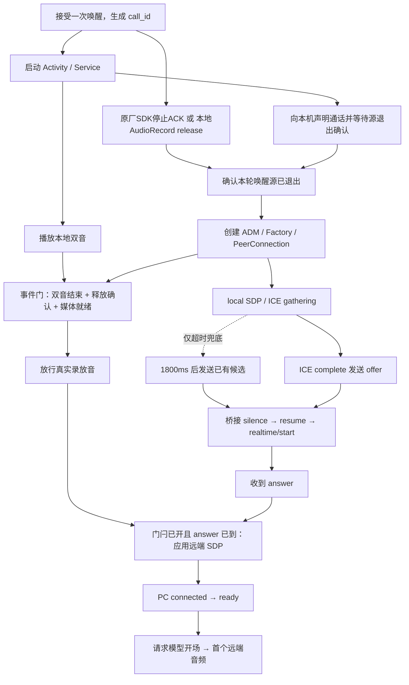

# 架构与启动时序

## 先对上几个词

| 词 | 在本项目里是什么 |
|---|---|
| KWS | 本地唤醒词检测，只判断有没有叫它，不负责听懂整句话 |
| WebRTC | 麦克风与扬声器的双向音频传输 |
| bridge / 桥接 | 管理机上的 Python 服务，协调会话和信令 |
| app-server | 已登录的本机 Codex 服务，提供对话、工具任务与实时控制协议 |
| thread / 主对话 | 一份持续保留的对话上下文，不是另起一个聊天窗口 |
| SDP / ICE | 前者交换媒体参数，后者寻找可用的网络连接候选 |
| ADM / PeerConnection | WebRTC 的音频设备入口 / 一次媒体连接；下图供维护者定位启动阶段 |

## 各组件在哪里，各做什么

**小度设备**默认复用原厂“小度小度”声学唤醒。在原厂成功事件进入提示/ASR/业务分发之前接管，暂停原厂唤醒会话，启动自己的实时语音客户端。释放确认来自SDK真实停止回调（`factory_sdk_stop_ack`），不能叫作Java AudioRecord.release或整机麦克风断电。

可选本地模式仍使用sherpa-onnx JNI、16kHz/MIC/单线程及“真维斯”；仅此模式关闭原厂唤醒并以实际AudioRecord.release作为交接确认。两套入口互斥，本地阈值不作用于原厂模式。

设备HTTP复用原厂DCS进程；root辅助进程只提供固定系统操作。闹钟/倒计时、通知、摄像头策略通过launcher现有IPC与原厂引擎，蓝牙和媒体使用现有Android能力；HTTP不提供任意shell。

**小度设备内的语音 APK**在命中后显示光球并播放 240ms 双音，接管麦克风、创建 libwebrtc，配置软件 AEC/NS/AGC。双音是确定的本机反馈，不依赖模型先返回一句话。光球使用音频回调的电平，不保存声音。

**Linux 管理机**运行 Python 桥接，通过当前用户已有 Codex app-server 连接固定的主 thread。`thread/realtime/start` 以 v3/WebRTC 建立该 thread 的实时语音；后台工具执行模型与实时语音模型分工，不能把“同一 thread”理解成两个模型完全相同。桥接做信令和任务协调，不承担实时 PCM 转码。

**OpenAI 云端**运行实时语音模型及后台任务模型；本机 app-server 负责会话、工具和任务编排。这里的“同一主对话”是共享的工作上下文，不表示模型在小度上离线运行。

## 启动中真正的并行关系

媒体初始化可与双音剩余部分重叠，先关闭真实录放音；门控条件满足后才打开。不能在唤醒源仍占用时开始 WebRTC AudioRecord，也不能把提示音播进上行。这里用释放确认和完成事件，而不是盲等一个固定交接时间。

1800ms 是 ICE gathering 没完成时的兜底，**不是每次启动固定等待 1.8 秒**。`ICE_COMPLETE` 到达就会提前发送 offer 并取消兜底。服务器的 resume、实时初始化、网络协商以及模型首音仍需真实测量；本地少等一段时间不等于整体首音一定同比变快。

## 对话、插话与退出

用户音频与模型声音在 WebRTC 中双向流动，AEC/NS/AGC 帮助处理外放；实际房间回声与远场质量需要本人验证。实时语音与同一主 thread 交互，需工具的任务交给 Codex 后台。普通文本空闲走 `turn/start`，忙时走 `turn/steer`，不另设排队语音总管。

用户有结束聊天意图时，主对话按Skill调用 `xiaodu voice end`；仅设备HTTP不可用时使用管理机 `codex-conversations voice-end` 兜底。桥接停止该 thread 的实时会话；设备观察结束，释放 PeerConnection、音频设备和唤醒锁，通知模块恢复所选唤醒入口。关闭音频不取消已经启动的后台工作。连接失败、客户端退出和桥接丢失也有收尾路径。

普通 HTTP 通知是独立的文字 TTS 路径。桥接只自动播报主对话的公开回复；实时通话中抑制这条路径，避免同一句话播两遍。后台项目会话只回报主对话。

## 不依赖什么

日常音频不走 ADB、Frida RPC 或管理机上的音频 worker。Frida inject 只在设备内加载 Java 服务，随后退出；watcher 仅做设备内加载恢复。Android APK 使用原生视图与 libwebrtc，没有 WebView 和大型前端框架。

## 提示词与声音

长期职责只维护在主对话AGENTS.md，设备步骤由Skill维护；桥接启动说明只补充当前使用原生实时音频这一上下文。语音层知道工具、改口、挂断和现场视觉需要交给同一Codex执行，不替代真实工具结果。开场问候只在匹配本轮ready后发起一次appendSpeech，初始提示不再要求另一轮自动问候。

远端WebRTC音轨使用SDK原生setVolume(1.4)，在混音和软件回声参考之前应用，随后仍经过系统媒体音量。1.4约+2.92dB，不是主观响度倍数或把系统音量50%变70%；音乐、HTTP TTS和双音不乘这个系数。通话摘要remote_playback_gain表示实际设置的倍数。
